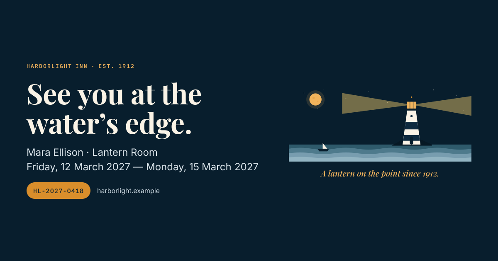
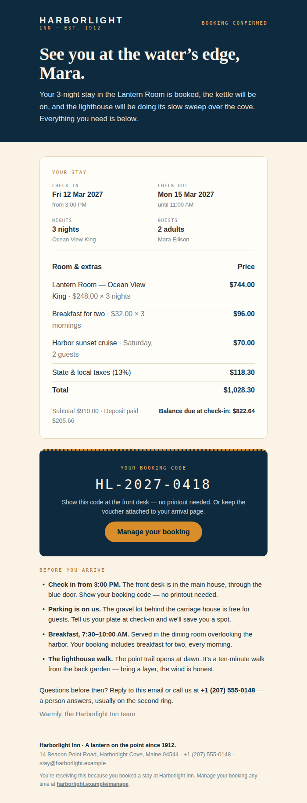
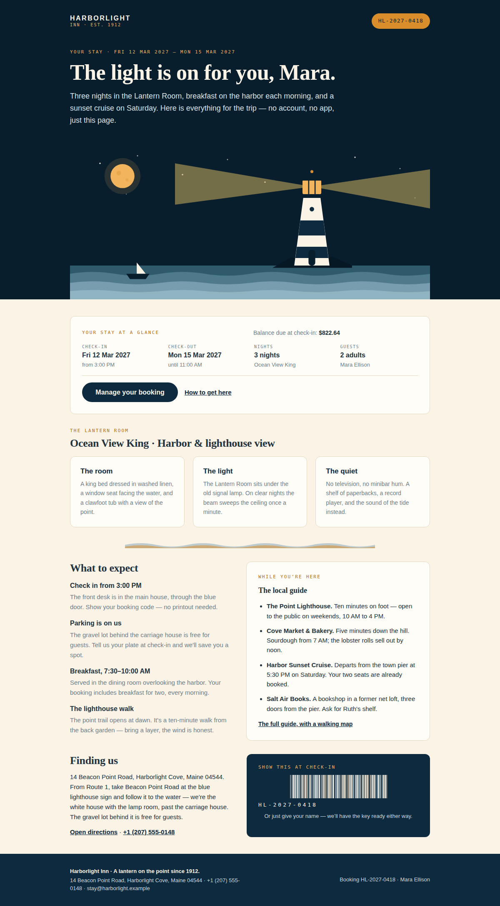
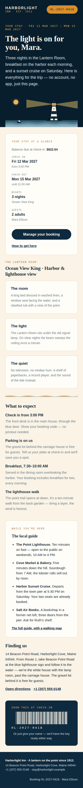
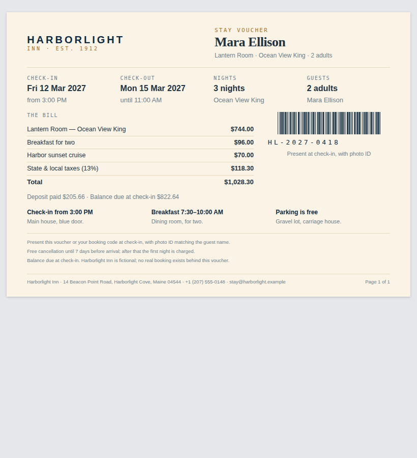
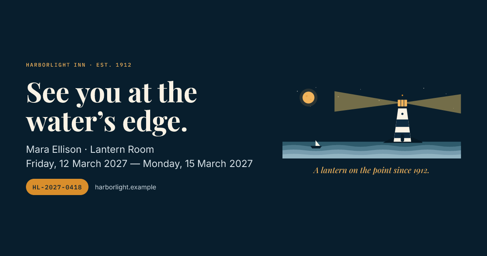

# Harborlight Inn — a boutique coastal inn booking kit

One fictional inn, one booking, four outputs — all from a single data file,
a single theme, and a set of shared components, written with
[Hyper Elements](https://github.com/hyper-elements/hyper-elements)
(`@hyper-elements/react`).

Harborlight Inn is a twelve-room inn on a Maine cove, under a lighthouse
that has swept the water since 1912. This kit is everything a guest gets
after booking a stay: the confirmation email, the arrival page, a printable
stay voucher, and a share card for the trip. Every visual is drawn in code
— there are no image assets anywhere in the project.



## The four outputs

### 1. Booking confirmation email (600px)



A warm welcome, the stay summary as a table, a dark ticket-style card with
the booking code, a manage-booking button, and what to expect on arrival.
`render()` also produces its plain-text twin (`out/email.txt`), and the
build writes per-client previews showing the email as classic Outlook,
Gmail and Apple Mail draw it (`out/clients/`).

### 2. "Your stay" arrival page (960px)



The page a guest opens from the email: a dusk hero with the lighthouse
drawn as Svg shapes, the stay at a glance, the room, what to expect, a
local guide, directions, and the barcode to show at check-in. It stacks
cleanly on phones:



### 3. Printable stay voucher — A5 landscape, HTML + PDF



One page, meant to be printed or shown on a phone at the front desk: the
guest, the stay, the bill, the fine print, and the booking code as a **real
Code 39 barcode** — drawn from Svg rectangles, encoded from the booking
code with ZXing's own table, and verified by a decode round-trip in the
build (and, as a final check, decoded back from a screenshot of the
rendered voucher). Change the code in `src/data.ts` and the bars change with it.

### 4. Social / Open Graph share card (1200 × 630)



Composed like a poster — serif headline, dates, tagline, booking-code pill,
the lighthouse at dusk — and rendered by `renderImage()` to PNG and SVG.

## How Hyper Elements was used

- **One theme, four roots.** `src/theme.ts` defines the brand once with
  `defineTheme()`: deep navy + warm cream + amber, Playfair Display for
  display type, Inter for body, IBM Plex Mono for codes and labels. The
  same theme is handed to the `Email`, `Page`, `Document` and `Canvas`
  roots, so all four outputs are on brand by construction. Named styles
  (`card`, `darkCard`, `eyebrow`, `metaLabel`, `pill`) are applied with
  `style={{ apply: [...] }}`, and the Button gets a type scale and
  `amber` / `light` variants.
- **Shared components.** `src/components.tsx` holds blocks reused across
  roots: `Wordmark`, `StayFacts`, `BookingBarcode`, `FooterNote`, and
  `LighthouseScene` — the lighthouse at dusk, drawn entirely from `Svg`
  shapes (`Rect`, `Circle`, `Polygon`, `Path`): stars, a moon, light
  beams, the striped tower, layered waves and a small boat. The email
  can't use Svg, so its shared blocks are text-only and it leans on the
  theme's colors and the ticket card instead.
- **One data model.** `src/data.ts` is the single source of truth: guest,
  room, dates, price lines, taxes, deposit, booking code. Money is integer
  cents with one formatter; dates are fixed strings, so every build
  renders identical output.
- **All four roots, all four writers.** `render()` writes the email HTML +
  plain text, the page HTML and the voucher's print HTML;
  `renderPdf()` (`@hyper-elements/react/pdf`) writes the voucher PDF;
  `renderImage()` (`@hyper-elements/react/image`) writes the share card
  as PNG and SVG. The PDF and the image get their fonts as local TTF
  files (`assets/fonts/`) — nothing is fetched at build time.
- **Validation as a build gate.** `scripts/build.ts` runs `validate()` on
  all four templates and fails on any error. The email is additionally
  checked with the `@hyper-elements/email-clients` plugin, and
  `renderInEmailClients()` writes a preview per client. The current build
  is clean: **0 errors, 0 warnings** on every template and render. (The
  plugin still reports info-level notes — e.g. classic Outlook draws no
  rounded corners and no 500-weight type — which are graceful
  degradations, not defects.)
- **A barcode that scans.** `src/barcode.ts` implements Code 39 from
  ZXing's `CHARACTER_ENCODINGS` table, copied verbatim as hex so no
  pattern is ever transcribed by hand. The build encodes the booking
  code, decodes the bars back, and fails if the round trip differs.

## Run it

```bash
npm install
npm run build        # validate + render everything into out/
npm run screenshots  # Playwright captures of each output, into docs/screenshots/
npm run typecheck    # tsc --noEmit
```

Requires Node 20+. Outputs land in `out/`:

| File | What it is |
| --- | --- |
| `out/email.html`, `out/email.txt` | Confirmation email + plain-text twin |
| `out/page.html` | Arrival page |
| `out/voucher.html`, `out/voucher.pdf` | Stay voucher, print HTML + PDF |
| `out/share-card.png`, `out/share-card.svg` | Share card, 1200 × 630 |
| `out/clients/*.html` | The email as Outlook, Gmail and Apple Mail draw it |

## Make it yours

Change the booking in `src/data.ts` — guest, room, dates, price lines,
booking code — and rebuild. The email, page, voucher (including its
barcode) and share card all follow. Recolor the kit by editing `palette`
in `src/theme.ts`; the drawn lighthouse and waves use the same palette, so
they follow too.

## Project structure

```
src/
  data.ts        the booking: guest, room, dates, prices, code (edit this)
  theme.ts       defineTheme(): colors, fonts, type scale, named styles
  barcode.ts     Code 39 encoder + decoder (ZXing's table, round-trip checked)
  components.tsx shared blocks: Wordmark, LighthouseScene, StayFacts,
                 BookingBarcode, FooterNote
  email.tsx      confirmation email (Email, 600px)
  page.tsx       arrival page (Page, 960px)
  document.tsx   stay voucher (Document, A5 landscape)
  canvas.tsx     share card (Canvas, 1200 x 630)
scripts/
  build.ts       validate gate + all renders + email-client previews
  screenshot.ts  Playwright captures for visual checks
assets/fonts/    TTFs for the PDF and share-card renders (OFL, see README there)
docs/screenshots/ captures of the rendered outputs (+ the share-card PNG)
docs/share-card.svg  the share card as SVG, for the README (copied by the build)
out/             build outputs (gitignored)
```

## Notes

- Harborlight Inn is fictional, and so is the booking — the voucher says
  so in its fine print. The `.example` domain is reserved for exactly this.
- The barcode is a genuine Code 39 symbol (2.5:1 wide-to-narrow ratio,
  quiet zones, `*` start/stop), with no Mod 43 check digit — optional in
  the symbology.
- The HTML outputs reference Google Fonts web fonts; the PDF and share
  card use the same families from local TTF files, so the build works
  offline once installed.

## License

MIT — see [LICENSE](LICENSE). Fonts are under the SIL Open Font License
(see `assets/fonts/README.md`).
